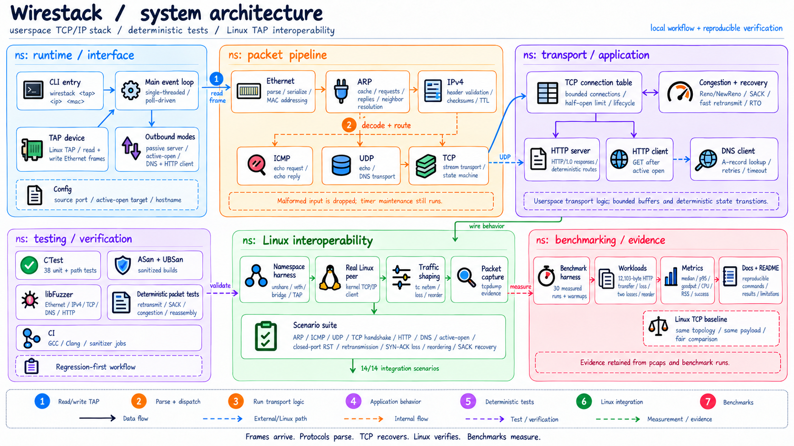

# wirestack

A userspace TCP/IP network stack in C++20, built from a Linux TAP device up
through Ethernet, ARP, IPv4, ICMP, UDP, TCP, and a minimal HTTP server. This
is a learning project: the goal is understanding the protocols by
implementing them, not feature completeness or performance.

## Architecture



Incoming frames are parsed and validated at each protocol boundary before
dispatch. The event loop owns the ARP cache, TCP connection table, DNS state,
and HTTP sessions; after packet handling it advances neighbor resolution, DNS,
TCP retransmission, persist, and connection-lifecycle timers. Outbound packets
use the same protocol serializers in the reverse direction and are written to
the TAP device.

## Status

| Protocol    | Status                                                          |
|-------------|-------------------------------------------------------------------|
| Ethernet II | implemented                                                       |
| TAP I/O     | implemented                                                       |
| ARP         | bounded cache and outbound neighbor resolution                    |
| IPv4        | implemented: local, unfragmented, base-header only                |
| ICMP Echo   | implemented                                                       |
| UDP         | implemented: basic unicast + built-in echo endpoint                |
| TCP         | passive and active open, bounded state, retransmission, Reno/NewReno, SACK, and orderly/reset close; see [docs/tcp.md](docs/tcp.md) |
| HTTP        | minimal HTTP/1.0 GET server and client; see [docs/http.md](docs/http.md) |
| DNS         | bounded UDP A-record lookup for the HTTP client; see [docs/dns.md](docs/dns.md) |

- `MacAddress` / `Ipv4Address`: parsing, formatting, equality
- Ethernet II frame parsing and serialization
- Linux TAP device I/O (`wirestack::TapDevice`): open, read, write
- ARP request/reply parsing and serialization, request handling, bounded cache
  entries with expiration, and timer-driven outbound neighbor resolution
- IPv4 header parsing/serialization/checksum, local-delivery filtering
- ICMP Echo Request/Reply parsing, serialization, and checksum
- UDP datagram parsing/serialization with the IPv4 pseudo-header checksum, a
  minimal `UdpEndpointTable`, and a built-in echo endpoint on port 9000
- TCP segment parsing/serialization with the IPv4 pseudo-header checksum, a
  4-tuple `TcpConnectionTable`, a passive handshake (LISTEN implicit /
  SYN_RECEIVED / ESTABLISHED) that parses and negotiates a SYN's MSS,
  Window Scale, and SACK-Permitted options (IPv4 default 536-byte MSS
  fallback, Window Scale clamped to 14, all fixed for the connection's
  lifetime), sequence-space
  tracking, a bounded (262144-byte) per-connection application send
  buffer with atomic enqueue/backpressure and FIFO ordering across
  enqueue calls, scheduled by every ACK/window update into
  effective-MSS-bounded segments (sized to the negotiated peer MSS,
  capped at 128 segments per scheduling pass) gated by both the peer send
  window and the congestion window, bounded out-of-order receive
  reassembly (first-arrival-wins overlap trimming, a
  262140-byte/128-fragment internal bound, out-of-order FIN retention)
  with a dynamically advertised, correctly scaled-when-negotiated receive
  window, cumulative and partial ACK processing with matching send-buffer
  capacity release, RTT sampling with Karn's rule (triggered by either a
  timeout or a duplicate-ACK fast retransmit) feeding an adaptive
  SRTT/RTTVAR/RTO estimator (1s/60s bounds) that drives timeout-based
  retransmission of SYN-ACK/data/FIN with cumulative/partial ACK
  retirement, a per-connection Reno-style congestion window (initial
  window sized from the negotiated MSS, Slow Start, Congestion Avoidance,
  precise duplicate-ACK classification, third-duplicate-ACK fast
  retransmit, NewReno-style partial-ACK recovery, a bounded
  segment-granular SACK scoreboard used to skip already-acknowledged
  segments during selective retransmission when SACK was negotiated, and
  timeout congestion collapse, all gating new application data alongside
  the peer's advertised window), a deterministic zero-window persist
  probe (1s-60s exponential backoff,
  narrowly scoped to unsent data with no sequence space outstanding),
  passive/active/simultaneous close
  (FinWait1/FinWait2/CloseWait/Closing/LastAck, FIN deferred until all
  queued application bytes enter sequence space) with a deterministic
  60-second TIME_WAIT, acceptable-inbound-RST handling, and closed-port
  RST generation
- A bounded, stateless HTTP/1.0 request parser (`wirestack::http`) layered
  above TCP: GET-only, `/` -> 200 with a fixed body, `/sack-test` -> 200
  with a deterministic 12,000-byte integration body, any other valid path
  -> 404, unsupported method -> 405, unsupported version -> 505,
  malformed/oversized/incomplete-at-EOF requests -> 400; one request per
  connection, response and close sent through the existing TCP
  retransmission/FIN machinery
- `wirestack` executable: opens a TAP interface with a configured local
  IPv4/MAC, decodes incoming Ethernet frames, answers ARP requests, ICMP
  Echo Requests, UDP datagrams to its echo endpoint, and serves the
  HTTP/1.0 demonstration on its TCP listening port
- `tools/tap_send`: writes one fixed Ethernet frame out through a TAP
  interface, to verify the transmit path

See [docs/tap.md](docs/tap.md), [docs/arp.md](docs/arp.md),
[docs/ipv4.md](docs/ipv4.md), [docs/icmp.md](docs/icmp.md),
[docs/udp.md](docs/udp.md), [docs/tcp.md](docs/tcp.md), and
[docs/http.md](docs/http.md) for setup, permissions, and manual
single-command checks. [docs/interoperability.md](docs/interoperability.md)
documents an automated, isolated-namespace harness
(`tools/integration/run.sh`) that reproducibly proves ARP resolution,
ICMP echo, UDP echo, a real TCP handshake, a real `curl --http1.0`
request, ordinary and reset connection close, HTTP response timeout
retransmission, SYN-ACK loss recovery, and out-of-order TCP segment
delivery with receiver-side SACK generation and sender-side multi-segment
SACK recovery, all against a real Linux kernel client with packet-capture
evidence.

[docs/benchmark.md](docs/benchmark.md) documents the reproducible short-transfer
benchmark, its Linux TCP baseline, exact-loss/reordering scenarios, recorded
results, and comparison limitations.

Not implemented: TCP simultaneous open, a general ephemeral-port
allocator, DSACK, RFC 6675 pipe-based recovery, PRR,
Limited Transmit/CUBIC/BBR/ECN/timestamps (persist is implemented, but
only for the narrow no-outstanding-data case; SACK coverage is
segment-granular, not sub-range, and reneging recovery beyond clearing
the scoreboard on RTO is not implemented -- see docs/tcp.md),
HTTP/1.1/keep-alive/pipelining/request bodies/chunked encoding/TLS, a
general-purpose or RFC-complete DNS resolver (see docs/dns.md: A/IN over
UDP only, one configured server, one question, no CNAME following, no
AAAA, no caching, no EDNS, no DNSSEC, no DNS over TCP), IPv4 options,
fragmentation, routing.

## Structure

```
include/wirestack/   public headers
src/                  implementation, wirestack executable
tests/                unit tests (CTest, no external test framework)
tools/                command-line utilities (tap_send)
tools/bench/          isolated Wirestack/Linux TCP benchmark
tools/integration/    isolated-namespace Linux interoperability harness
fuzz/                 optional Clang/libFuzzer parser targets and seed corpora
docs/                 protocol notes
```

## Build

```bash
cmake -S . -B build
cmake --build build -j
ctest --test-dir build --output-on-failure
```

With AddressSanitizer and UndefinedBehaviorSanitizer:

```bash
cmake -S . -B build-asan -DWIRESTACK_ENABLE_SANITIZERS=ON
cmake --build build-asan -j
ctest --test-dir build-asan --output-on-failure
```

Optional parser fuzzers require Clang and use libFuzzer with ASan and UBSan:

```bash
cmake -S . -B build-fuzz -DCMAKE_CXX_COMPILER=clang++ \
  -DWIRESTACK_ENABLE_FUZZING=ON
cmake --build build-fuzz -j
```

## Running

Opening a TAP device requires `CAP_NET_ADMIN` (root, in practice):

```bash
sudo ./build/wirestack wire0 10.0.0.2 02:00:00:00:00:02
```

See [docs/tap.md](docs/tap.md) for host-side interface configuration and how
to observe frames with `tcpdump`, [docs/arp.md](docs/arp.md) for testing ARP
resolution end to end, [docs/udp.md](docs/udp.md) for testing the UDP echo
endpoint (port 9000), [docs/tcp.md](docs/tcp.md) for the TCP handshake and
close/reset behavior, and [docs/http.md](docs/http.md) for testing the
HTTP/1.0 demonstration on port 8080 with `curl`.
